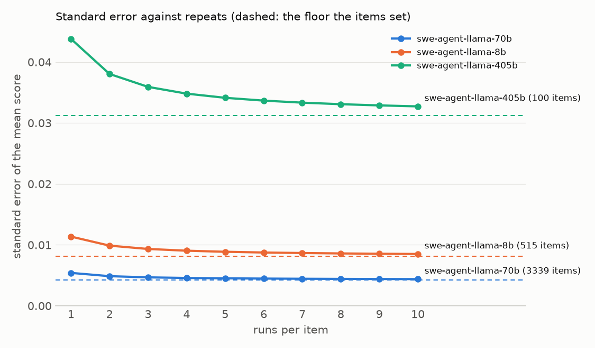

# repvar

From repeated runs of a stochastic system on the same benchmark items, repvar separates the variance that comes
from which items were chosen from the variance that comes from rerunning, and says how to split an evaluation
budget between more items and more repeats.

## Why this is hard

An agent run twice on the same benchmark gives two different scores, and a single reported run hides that. The
usual error bar is computed over items from one run, so it cannot say how much of the uncertainty would go away
with repeats and how much is set by the item sample. Repeating everything is expensive, so the split matters:
when the items are a sample, repeats only shrink one part of the error; when two systems are compared on the
same items, the item part mostly cancels and the rerun part is what is left. Getting these parts needs a
variance-components analysis, on data that are usually 0/1, often unbalanced (different numbers of runs per
item), and sometimes crossed (run 3 is the same pass over every item) rather than nested.

## Install

```
pip install git+https://github.com/vipul21435/repvar
```

Python 3.10 or later. Depends on numpy and scipy; the chart needs matplotlib (`pip install matplotlib`).
To work on it: `uv run --extra dev ruff check` and `uv run --extra dev pytest -q`.

## Quickstart

Input is a long JSONL, CSV or TSV file with one row per (item, run): an item column, a score column (0/1,
true/false, pass/fail words or a real number), optionally a run column and a system column. Column names are
set with `--item-col`, `--run-col`, `--score-col` and `--system-col`.

`examples/runs.csv` is a small made-up table: 8 items, 4 runs each, 0/1 scores.

```
$ repvar components examples/runs.csv --design nested --bootstrap 500 --seed 1
# Variance components

## all

design: nested (runs independent within items); method: one-way ANOVA
items: 8; scores: 32; runs per item: 4.00 (balanced); mean score: 0.5625

| component | variance | share |
| --- | --- | --- |
| item | 0.09673 | 36.7 % |
| residual | 0.16667 | 63.3 % |

| design | standard error | from items | from reruns | rerun share of variance |
| --- | --- | --- | --- | --- |
| 8 items x 1 run(s) | 0.1815 | 0.1100 | 0.1443 | 63.3 % |
| 8 items x 4 run(s) | 0.1315 | 0.1100 | 0.0722 | 30.1 % |

- intraclass correlation ICC(1,1): 0.3672 (95 % interval 0.0375 to 0.7736; F, exact under normality)
  (this F interval assumes normal effects and can under-cover on 0/1 scores: prefer the --bootstrap interval)
- reliability of an item's score: 0.3672 from 1 run, 0.6989 from the mean of 4 runs
- of the 8 items with 2+ runs: always solved 25.0 %, sometimes 62.5 %, never 12.5 %

beta-binomial fit: mean 0.5644, rho 0.3154 (alpha 1.225, beta 0.946)
- log-likelihood -12.74 against -14.59 for one shared pass probability (likelihood ratio 3.71, p 0.027)
- item variance 0.07754, rerun variance 0.16831
- expected share of items solved sometimes: 2 runs 33.7 %, 5 runs 67.3 %, 10 runs 82.4 %

bootstrap intervals (95 %, percentile):

| quantity | estimate | low | high |
| --- | --- | --- | --- |
| mean | 0.56250 | 0.31250 | 0.81250 |
| item | 0.09673 | 0.00000 | 0.18080 |
| residual | 0.16667 | 0.06250 | 0.26042 |
| icc | 0.36723 | -0.05105 | 0.70386 |
| reliability_one_run | 0.36723 | 0.00000 | 0.70386 |
| se_one_run | 0.18145 | 0.14364 | 0.18525 |
| se_observed | 0.13153 | 0.08653 | 0.15978 |
| sometimes | 0.62500 | 0.25000 | 1.00000 |
```

The "from items" and "from reruns" columns are standard errors; their squares add up to the square of the
total. A decision study spends a budget of item-runs in every possible way:

```
$ repvar design examples/runs.csv --design nested --budget 64 --max-items 8 --max-runs 8
# Decision study

## all

design: nested (runs independent within items); method: one-way ANOVA
variance: item 0.09673, residual 0.16667

budget: 64 item-runs

| runs per item | items | cost | standard error | from items | from reruns |
| --- | --- | --- | --- | --- | --- |
| 1 | 8 | 8 | 0.1815 | 0.1100 | 0.1443 |
| 2 | 8 | 16 | 0.1500 | 0.1100 | 0.1021 |
| 3 | 8 | 24 | 0.1380 | 0.1100 | 0.0833 |
| 4 | 8 | 32 | 0.1315 | 0.1100 | 0.0722 |
| 5 | 8 | 40 | 0.1275 | 0.1100 | 0.0645 |
| 6 | 8 | 48 | 0.1248 | 0.1100 | 0.0589 |
| 7 | 8 | 56 | 0.1227 | 0.1100 | 0.0546 |
| 8 * | 8 | 64 | 0.1212 | 0.1100 | 0.0510 |

best split (*, smallest standard error): 8 items x 8 run(s), standard error 0.1212
with 8 items the standard error cannot go below 0.1100; 17 run(s) per item bring it within 5 % of that
```

The other commands:

- `repvar compare FILE --system-col COL --a NAME --b NAME` gives the difference of two systems on their shared
  items, the split of its standard error into an item part and a rerun part, and the smallest difference a
  design with 1, 2, 3, 5 or 10 runs per system would detect.
- `repvar simulate --items 200 --runs 5 --mean 0.3 --icc 0.4` writes simulated scores as CSV;
  `--coverage REPS` instead reports how often the intervals contain the planted values.
- `--format json` on every command, `--output PATH` to write to a file, `--chart PATH` on `design` for a PNG
  of standard error against runs per item, `--first-runs K` to cut an unbalanced file down to the first K
  scores of every item that has K or more.

`examples/quickstart.py` does the same through the Python API.

## How it works

**Two designs.** In a *nested* design the runs of one item have nothing to do with the runs of another: the
model is `x_ij = mu + a_i + e_ij` with variances `item` and `residual`. In a *crossed* design run `j` is one
pass over all items (one seed, one checkpoint), so a whole run can be good or bad:
`x_ij = mu + a_i + b_j + e_ij` with variances `item`, `run` and `residual`. `--design auto` picks crossed when
the file has run labels and every label covers at least two items; a run column that only counts repeats should
be overridden with `--design nested`.

**Variance components by ANOVA.** Nested: with `MS_item` the between-item and `MS_res` the within-item mean
square, `residual = MS_res` and `item = (MS_item - MS_res) / k0`, where `k0 = (N - sum(k_i^2) / N) / (n - 1)`
for `n` items with `k_i` runs and `N` scores in all; `k0` is the common number of runs when the design is
balanced. Crossed: on a complete table, `item = (MS_item - MS_res) / k`, `run = (MS_run - MS_res) / n` and
`residual = MS_res`. With missing cells the same idea is applied to the cells that are present: the
uncorrected sums of squares of the item totals, the run totals and the single scores are set equal to their
expectations under the model, which gives three linear equations in the three variances. Negative estimates
are reported and then set to zero. The reported mean score is the mean of the per-item means, so every item
counts once whatever its number of runs. This is the variance-components view of generalizability theory
([Cronbach and others 1972](https://openlibrary.org/books/OL5709045M);
[Shavelson and Webb 1991](https://openlibrary.org/books/OL1543093M);
[Brennan 2001](https://doi.org/10.1007/978-1-4757-3456-0)).

**Standard error of a mean score** over `n` items with `k` runs each:

```
Var(mean) = item / n  +  run / k  +  residual / (n k)
            item part    rerun part (run term is zero when nested)
```

With one run and a nested design this equals, in expectation, the usual items-only error bar
`sd(scores) / sqrt(n)`: that error bar does contain the rerun noise, it just cannot separate it. The split is
what says that more runs can only remove the rerun part, and that with the item set held fixed the rerun part
is the whole error.

**Reliability.** With items as the objects of measurement, the generalizability coefficient of an item's mean
over `k` runs is `item / (item + (run + residual) / k)`: the expected squared correlation between that mean
and the item's long-run score. For `k = 1` it is the intraclass correlation.

**Intraclass correlation with an interval.** `ICC(1,1)` for the nested design and `ICC(2,1)` (absolute
agreement) for the complete crossed design, in the numbering of
[Shrout and Fleiss 1979](https://doi.org/10.1037/0033-2909.86.2.420), with the F-distribution intervals for
the one-way table (exact under normal effects; with unequal runs `k0` replaces `k`, an approximation) and for
the two-way table (Satterthwaite degrees of freedom). These intervals assume normal effects. On 0/1 scores
they can be badly off (see the simulation below), so the bootstrap interval is the one to use there.

**Beta-binomial fit for 0/1 scores.** Each item has a pass probability `p_i ~ Beta(alpha, beta)` and its
runs are independent trials. With `mu = alpha / (alpha + beta)` and `rho = 1 / (alpha + beta + 1)`, the item
variance is `rho mu (1 - mu)` and the rerun variance `(1 - rho) mu (1 - mu)`, so `rho` plays the part of the
intraclass correlation. The fit is by maximum likelihood; the report gives the log-likelihood, the
log-likelihood of a single shared pass probability, and the likelihood-ratio statistic with a p-value from
the half-and-half mixture of zero and chi-square(1), since `rho = 0` is on the edge of the parameter space.

**Solved sometimes.** The observed share of items (among those with two or more runs) whose runs are neither
all passes nor all failures. This share grows with the number of runs, so the report also gives the share the
beta-binomial fit expects for `k` runs, `1 - E[p^k] - E[(1 - p)^k]`.

**Decision study.** A design with `n` items and `k` runs costs `n (k + c)` item-runs, where `c` is an
optional one-off cost per item. For a budget, `repvar design` lists the standard error of every split
(`--max-items` caps `n` for a benchmark of fixed size) and marks the best. It also reports the plateau: with
`n` items the standard error cannot go below `sqrt(item / n)`, and the smallest `k` that comes within a
tolerance `t` of that floor is `k >= (run + residual / n) / (((1 + t)^2 - 1) item / n)`.

**Comparing two systems** on shared items, with the runs of one system independent of the runs of the other.
For per-item means `A_i` and `B_i`,

```
Var(mean(A_i - B_i)) = delta / n + (residual_A / k_A + residual_B / k_B) / n   (+ run_A / k_A + run_B / k_B)
```

where `delta` is the variance across items of the true per-item difference. Because the runs are independent,
rerun noise does not enter the covariance of the two systems' item means, so `delta` is the variance of the
observed per-item differences minus the rerun terms. The smallest detectable difference for a design is
`(z_(1 - alpha/2) + z_power) * SE`.

**Bootstrap.** Percentile intervals from resampling items with replacement (`--resample items`, the default),
items and then runs (`items+runs`), or runs only with the items held fixed (`runs`). In a nested design runs
are redrawn within each item; in a crossed design whole runs are redrawn. Resampling items alone already
reproduces both parts of the error of the mean; redrawing runs as well counts the rerun noise a second time
and gives somewhat wider intervals.

Related reading: [Miller 2024](https://arxiv.org/abs/2411.00640) treats evaluations as
experiments and gives formulas for analysing evaluation data, comparing two models and planning evaluations;
[Madaan and others 2024](https://arxiv.org/abs/2406.10229) (Lovish Madaan, Aaditya K. Singh, Rylan Schaeffer,
Andrew Poulton, Sanmi Koyejo, Pontus Stenetorp, Sharan Narang, Dieuwke Hupkes) define and measure variance
metrics for benchmarks, seed variance among them; [Reimers and Gurevych 2017](https://arxiv.org/abs/1707.09861)
argue that a single score is not enough to compare non-deterministic methods and propose comparing score
distributions over several runs.

**Checks.** The tests compare the ANOVA components with hand-worked tables and with restricted maximum
likelihood fits from [statsmodels](https://www.statsmodels.org/stable/mixed_linear.html) mixed models, the
beta-binomial likelihood and fit with
[scipy.stats.betabinom](https://docs.scipy.org/doc/scipy/reference/generated/scipy.stats.betabinom.html),
recover planted components from simulated data, and check interval coverage by seeded simulation.
The suite has 84 tests with 99 % line coverage (`uv run --extra dev pytest -q --cov=repvar`) and takes
about 30 seconds, measured on a loaded laptop.

Interval coverage on simulated 0/1 data (500 items, 5 runs, mean 0.1, intraclass correlation 0.5; 400 data
sets, 400 bootstrap replicates, nominal 95 %; about 20 seconds, measured on a loaded laptop):

```
$ repvar simulate --items 500 --runs 5 --mean 0.1 --icc 0.5 --coverage 400 --bootstrap 400 --seed 1
# Interval coverage

400 simulated data sets of 500 items x 5 runs (mean 0.1, icc 0.5); nominal level 95 %; bootstrap over items, 400 replicates

| interval | covered the planted value |
| --- | --- |
| bootstrap: mean | 95.0 % |
| bootstrap: item variance | 93.2 % |
| bootstrap: icc | 92.0 % |
| F: icc | 68.8 % |
```

The bootstrap over items is close to nominal for the mean and a little under for the variance and the
intraclass correlation. The F interval for the intraclass correlation covers far too rarely on these skewed
0/1 scores, which is why the report flags it.

## Results on real public data

Data: [nebius/SWE-agent-trajectories](https://huggingface.co/datasets/nebius/SWE-agent-trajectories) on
Hugging Face, 80,036 agent trajectories on software-engineering issues, each with the instance it attempted
(`instance_id`), the model that produced it (`model_name`) and whether the issue was resolved (`target`).
The card states the licence as Creative Commons Attribution 4.0, and adds that the licences of the source
repositories should be respected and that outputs are subject to the Llama 3.1 licence. Only those three
columns were fetched (revision `68195a1450865274106246d0d0296a1d6807b88e`, 13 November 2026); no rows are
committed here.

```
uv run --no-project --with pyarrow --with huggingface_hub \
    python scripts/fetch_swe_agent_trajectories.py --out swe_agent_runs.csv
```

The file has three `model_name` values. The card does not say how the trajectories of one model on one
instance differ from each other (sampling only, or also settings), and the number of trajectories per instance
is far from constant (74,792 trajectories over 3,591 instances for the largest set). What follows therefore
describes these sets of trajectories; it is not a statement about the models. The number of trajectories per
instance also appears to be related to the outcome (last paragraph of this section), so the main analysis
uses a balanced subset: the first 5 trajectories, in dataset order, of every instance that has at least 5.

```
repvar components swe_agent_runs.csv --system-col system --first-runs 5 --bootstrap 1000 --seed 1
```

| system (`model_name`) | instances | mean score | item share | rerun share | reliability of a one-run score (95 % bootstrap) | solved always / sometimes / never |
| --- | --- | --- | --- | --- | --- | --- |
| swe-agent-llama-70b | 3339 | 0.1095 | 62.1 % | 37.9 % | 0.621 (0.593 to 0.648) | 3.7 % / 15.3 % / 81.0 % |
| swe-agent-llama-8b | 515 | 0.0715 | 51.2 % | 48.8 % | 0.512 (0.429 to 0.588) | 1.4 % / 13.6 % / 85.0 % |
| swe-agent-llama-405b | 100 | 0.2560 | 50.9 % | 49.1 % | 0.509 (0.397 to 0.616) | 7.0 % / 37.0 % / 56.0 % |

The beta-binomial fit agrees with the ANOVA split on this balanced subset (`rho` 0.621, 0.509 and 0.520) and
expects the "sometimes" share to reach 19.8 %, 17.7 % and 47.4 % with 10 runs.

Standard error of the mean score, from the same command (the last column is from
`repvar design swe_agent_runs.csv --system-col system --first-runs 5 --max-items 3339`):

| system | 1 run | of which items | of which reruns | 5 runs | floor with unlimited runs | runs to come within 5 % of the floor |
| --- | --- | --- | --- | --- | --- | --- |
| swe-agent-llama-70b | 0.0054 | 0.0043 | 0.0033 | 0.0045 | 0.0043 | 6 |
| swe-agent-llama-8b | 0.0114 | 0.0081 | 0.0079 | 0.0089 | 0.0081 | 10 |
| swe-agent-llama-405b | 0.0438 | 0.0312 | 0.0307 | 0.0341 | 0.0312 | 10 |

The one-run column is what the items-only error bar of a single run estimates. Five runs bring it down by 16
to 22 %, and no number of runs brings it below the floor. If new instances were available at the same cost
per run, they would be the better buy: for the 405b set, 500 instance-runs give 0.0196 as 500 instances with
one run each against 0.0341 as 100 instances with five.



Comparing two systems on the instances both have (again the first 5 trajectories each):

```
repvar compare swe_agent_runs.csv --system-col system --first-runs 5 \
    --a swe-agent-llama-70b --b swe-agent-llama-8b
repvar compare swe_agent_runs.csv --system-col system --first-runs 5 \
    --a swe-agent-llama-405b --b swe-agent-llama-70b
```

| pair | shared instances | difference (95 % interval) | standard error | unpaired standard error | rerun share with 1 run each | detectable difference, 1 run each | detectable difference, 5 runs each |
| --- | --- | --- | --- | --- | --- | --- | --- |
| 70b minus 8b | 515 | 0.0412 (0.0258 to 0.0565) | 0.0078 | 0.0147 | 79.2 % | 0.0363 | 0.0219 |
| 405b minus 70b | 100 | -0.1020 (-0.1471 to -0.0569) | 0.0230 | 0.0529 | 91.3 % | 0.1241 | 0.0645 |

**The finding, stated carefully.** In these trajectories, rerun noise is 38 to 49 % of the variance of a
single run's score when the instances are treated as a sample, and repeats stop helping after 6 to 10 runs.
For the difference between two systems on the same instances the picture changes: the instance effect largely
cancels, and with one run per system 79 % (515 instances) and 91 % (100 instances) of the variance of the
difference is rerun noise. There, five runs per system cut the smallest detectable difference from 3.6 to 2.2
points and from 12.4 to 6.5 points. This rests on the first five trajectories per instance being comparable
reruns, which the card does not establish, and on instances that have at least five trajectories.

Using every trajectory instead (`repvar components swe_agent_runs.csv --system-col system --bootstrap 1000
--seed 1`, 3591, 528 and 100 instances) gives intraclass correlations of 0.516 (0.495 to 0.538), 0.433 (0.343
to 0.521) and 0.441 (0.355 to 0.524) and "sometimes" shares of 22.3 %, 15.5 % and 46.0 %. In that unbalanced
analysis the beta-binomial fit and the ANOVA split disagree for the largest set (`rho` 0.576 against 0.516),
a sign that the number of trajectories per instance is related to the outcome.

## Limitations

- Items are the objects of measurement. There is no study with systems as a facet, so the reliability
  coefficient is about per-item scores, not about how well a leaderboard separates systems.
- The estimators are the ANOVA ones. There is no maximum likelihood or REML fit for unbalanced designs. With
  missing cells in a crossed design the estimator is unbiased under the random model but not efficient, and it
  assumes that which cells are missing is unrelated to the scores.
- When the number of runs per item depends on the outcome, the unbalanced analysis mixes two things;
  `--first-runs` gives a balanced subset but only for items with enough runs.
- One rerun variance is used for all items. For 0/1 scores it really differs by item (`p (1 - p)`); only the
  beta-binomial fit models that.
- The F intervals assume normal effects and under-covered in the 0/1 simulation above. The crossed-design
  interval exists for complete tables only.
- The bootstrap is the plain percentile method. Resampling items and runs together widens the intervals, and
  in a crossed design with few runs the resampling of runs is rough.
- The beta-binomial model has one beta distribution for all items, no run effect and no covariates.
- The decision study assumes equal cost per run and new items exchangeable with the observed ones.
- `compare` handles two systems at a time with a normal-approximation interval, makes no multiplicity
  correction and assumes the two systems' runs are independent (no shared seeds).
- Not implemented: designs with more than two facets (for example items by runs by prompts), and stopping
  rules for adding runs as results come in.

## Related tools

- [evalstats](https://github.com/vipul21435/evalstats): error bars and paired comparisons for evaluations,
  with intervals over items for one run. repvar starts where there are several runs per item.
- [evalstop](https://github.com/vipul21435/evalstop): confidence sequences and sequential tests, for deciding
  when to stop an evaluation as results arrive.
- [statsmodels mixed models](https://www.statsmodels.org/stable/mixed_linear.html): general mixed-model
  fitting by REML or maximum likelihood, for designs beyond the two covered here.

## Licence

MIT. Copyright (c) 2026 Vipul Raj Jha.

Built by Vipul Raj Jha · https://vipul21435.github.io
